<div align="center">

<picture>
  <source media="(prefers-color-scheme: dark)" srcset="assets/banner-dark.svg">
  
</picture>

</div>

```text
$ whoami
anas abuelhaag, software engineering student, ECU
azure ai engineer (AI-102) / senior microsoft student ambassador

$ cat focus.txt
ship llm systems end to end: web, mobile, cloud
```

<br>

### Shipped

|  |  |
| :-- | :-- |
| **[Qaid](https://github.com/a-elhaag/qaid)** <br> `live` | Two AI readers extract every receipt. A fusion step reconciles them. Checks flag the odd ones for an accountant. [qaid-bay.vercel.app](https://qaid-bay.vercel.app) |
| **[pyhusk](https://github.com/a-elhaag/pyhusk)** <br> `open source` | Prunes a FastAPI monorepo into minimal per-service Docker images with static import analysis. |
| **[glyphed.js](https://github.com/a-elhaag/glyphed.js)** <br> `npm` | Zero-dependency library that draws text as animated hand-drawn SVG. |
| **[Drift CLI](https://github.com/a-elhaag/drift-cli)** <br> `open source` | Natural language to shell commands with local LLMs, risk scoring and undo. |
| **[Biomass Model](https://github.com/a-elhaag/Biomass-Pyrolysis-Forward---Inverse-Model)** <br> `research` | Forward and inverse ML for pyrolysis yields. Built at HUST. |
| **Auscope** <br> `private` | AI usage observability platform with a multi-provider Python SDK. |

<br>

### Toolbox

<p>
            
</p>

<br>

### Activity

<div align="center">


</div>

<br>

### Published

- Cancer Treatment Protocol Advisor: Mobile Application Sets the Treatment Regimens
- An Integrated IoT Smart Cane for the Blind and Visually Impaired Individuals

<br>

<div align="center">

[LinkedIn](https://linkedin.com/in/anaselhaag) · [Website](https://anaselhaag.com) · [X](https://x.com/a.elhaag) · anaselhaag@outlook.com

</div>
